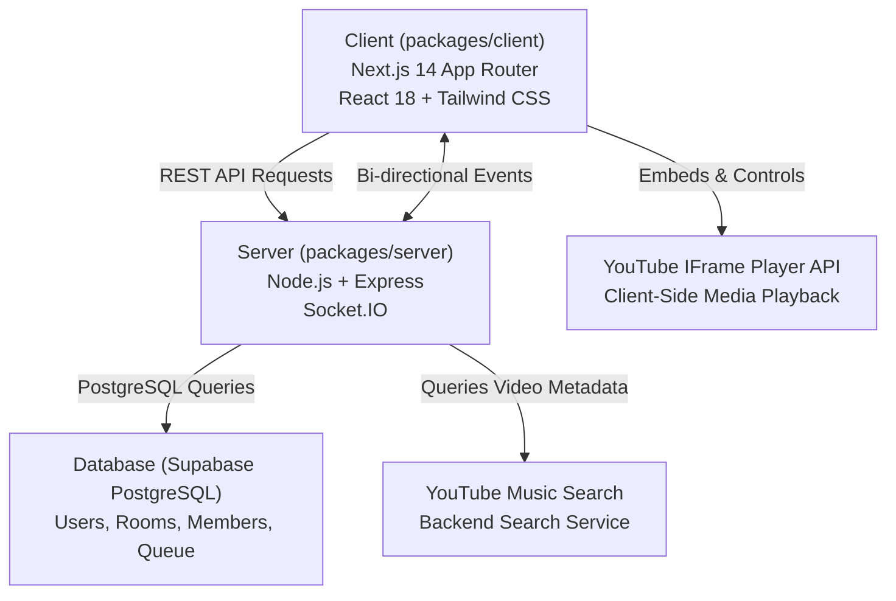

# 01. Project Overview — Jukebox Technical Audit

## 1. Executive Summary

**Jukebox** is designed as a real-time collaborative music listening and music-video watch party platform. The vision outlined in the Master Project Instruction is to provide a globally accessible, synchronized YouTube Music video party experience where hosts and remote participants (regardless of geographical location or local network boundaries) can watch official music videos and listen to music together with sub-second synchronization, automatic QR code invitations, seamless guest access, and native YouTube Music Audio/Video mode toggling.

This document serves as the foundational technical audit of the imported repository (`https://github.com/arkadealpha1/Jukebox`), identifying its existing architecture, current capabilities, critical architectural flaws, and the precise engineering gaps that must be bridged.

---

## 2. High-Level Architecture

The imported repository is structured as a TypeScript monorepo using npm workspaces:



### Monorepo Components:
1. **`packages/client`**: A Next.js 14 application utilizing React 18, Tailwind CSS, Framer Motion, Zustand for state management, TanStack React Query, and `socket.io-client`.
2. **`packages/server`**: An Express server running on Node.js with TypeScript, `socket.io` for real-time WebSockets, JWT authentication, and Supabase PostgreSQL client integration.
3. **`migrations/`**: A set of 4 PostgreSQL migration scripts (`001_create_users.sql` to `004_create_queue_items.sql`) defining the relational database schema.

---

## 3. Core Concept vs. Current Implementation Reality

The audit reveals a stark divergence between the envisioned YouTube Music Video Party platform and what was actually written in the baseline repository:

| Feature / Capability | User's Master Requirement | Baseline Repository Reality |
| :--- | :--- | :--- |
| **Media Type** | Official YouTube Music Video streaming with Audio/Video toggle mode | Disguised Audio Player: Uses an invisible 1px YouTube Iframe (`left: -9999px`) and displays only a static thumbnail ``. Video playback is completely absent. |
| **YouTube Music Association** | True song-to-official-video counterpart linking from YouTube Music | Generic YouTube text search scraped from `youtube.com/results` via HTML regex if a local microservice on `localhost:5000` is missing. |
| **Room Creation & Entry** | Anyone can create or join; instant unique QR code + invitation URL | Room creation requires email/password account login. No QR code generation exists anywhere in the codebase. |
| **Guest Access** | Unauthenticated participants can join with a temporary nickname | Broken: `/api/rooms/join` route and Socket.IO handshake strictly enforce registered JWT credentials (`401 Auth Required`). |
| **Audio/Video Mode Sync** | Synchronized video mode switching across all room members | Non-existent: No mode state in database, server memory, or socket protocol. |
| **Playback Synchronization** | Server-authoritative sync with drift compensation & late-joiner replay | Rudimentary: Basic in-memory timestamps without clock-drift correction, lost on server restart, and lacking host permission checks on play/seek. |
| **Deployment** | Vercel production frontend + global remote backend | Fails production client build due to `next/font/google` configuration errors; hardcoded `localhost` URLs in default configs. |

---

## 4. Key Findings from the Codebase Inspection

1. **The Disguised "Player" Problem**:
   In `packages/client/src/components/room/Player.tsx`, the component renders:
   ```tsx
   <motion.img src={thumbnailUrl} alt={currentTrack.title} className="aspect-video w-full object-cover" />
   ```
   And `usePlayer.ts` mounts the YouTube IFrame Player onto a dynamically injected `<div>` styled with `position: absolute; left: -9999px; width: 1px; height: 1px;`. The user was never actually watching a video—they were staring at a static image while audio played offscreen.

2. **The Authentication Gate Problem**:
   While the landing page UI provides a "Join a Room" card suggesting "Guest Entry", submitting the form triggers `roomService.joinRoom()`, which makes a POST request to `/api/rooms/join`. The server route definition (`packages/server/src/routes/room.routes.ts`) marks this route with the `authenticate` middleware. Unauthenticated guests receive a `401 Unauthorized` error.

3. **Socket Handshake Disconnect**:
   In `packages/server/src/sockets/index.ts`, `io.use()` rejects any connection lacking a JWT token. In `packages/client/src/sockets/index.ts`, the client sets `autoConnect: true` on initial load before any authentication token is acquired, resulting in immediate silent connection failure on page load.

4. **Missing YouTube Music Video Counterpart Logic**:
   The existing search service (`packages/server/src/services/search.service.ts`) attempts to hit a nonexistent local service at `http://localhost:5000/search` and then falls back to regex scraping of YouTube desktop HTML. It does not look up YouTube Music's song-to-video relationship or counterpart video IDs.

---

## 5. Summary of Audit Scope

The following 19 documents provide an exhaustive, evidence-backed inspection of every file, function, route, component, schema, and operational characteristic in the repository, followed by an actionable transformation roadmap.
