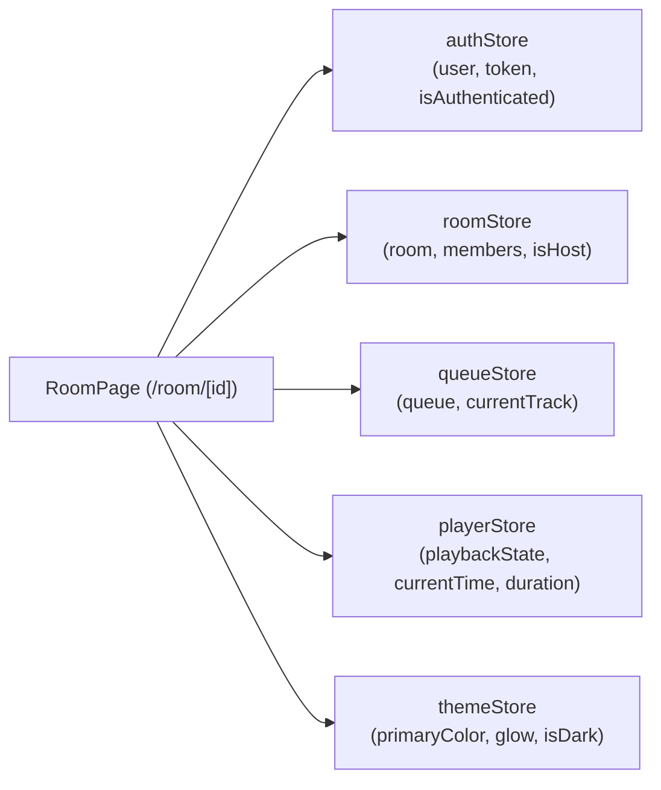

# 04. Frontend Architecture & Client Implementation

## 1. Application Architecture & Routing (Next.js 14 App Router)

The frontend is built upon Next.js 14 utilizing the App Router architecture. All application views are routed through file-system hierarchy under `packages/client/src/app`:

- **`/` (`src/app/page.tsx`)**: The primary landing interface. Displays the neon `Hero` component, active listening sessions for authenticated users, and two entry cards (`CreateRoomCard` and `JoinRoomCard`).
- **`/login` (`src/app/login/page.tsx`)**: Traditional email/password login screen using `LoginForm`.
- **`/signup` (`src/app/signup/page.tsx`)**: User registration screen using `SignupForm`.
- **`/join/[code]` (`src/app/join/[code]/page.tsx`)**: Deep-link invitation page accepting a 6-character room code via URL parameter, prompting for a nickname.
- **`/room/[id]` (`src/app/room/[id]/page.tsx`)**: The collaborative music listening room. Houses the player stage, playlist queue, participant list, search bar, and host controls.

---

## 2. State Management Architecture (Zustand Stores)

The client avoids monolithic state by organizing reactive state into five distinct, decoupled Zustand stores:



1. **`authStore.ts`**:
   - Manages user identity, JWT token, and login status.
   - Persists credentials to `localStorage` under `jukebox_token` and `jukebox_user`.
   - Distinguishes between registered users and guests (`isGuest` flag).
2. **`roomStore.ts`**:
   - Stores the active `Room` object, array of active `RoomMember` records, and boolean `isHost`.
   - Offers mutation actions: `setRoom`, `setMembers`, `addMember`, `removeMember`, `setIsHost`, `leaveRoom`.
3. **`queueStore.ts`**:
   - Maintains the playlist array `queue: QueueItem[]` and currently playing item `currentTrack: QueueItem | null`.
   - Provides helpers: `setQueue`, `setCurrentTrack`, `addTrack`, `removeTrack`, `reorderQueue`.
4. **`playerStore.ts`**:
   - Holds the instantaneous playback state: `playbackState: 'playing' | 'paused' | 'stopped' | 'buffering'`.
   - Stores `currentTime` (seconds) and `duration` (seconds).
   - Driven directly by the YouTube IFrame player polling interval and socket events.
5. **`themeStore.ts`**:
   - Dynamically adapts UI colors based on the current album cover artwork.
   - Variables: `primaryColor`, `secondaryColor`, `accentColor`, `backgroundColor`, `surfaceColor`.
   - Supports light/dark theme toggling (`toggleTheme`).

---

## 3. Media Playback Architecture & The Invisible Player

The centerpiece of the media playback experience resides in `usePlayer.ts` and `Player.tsx`.

### The `usePlayer` Hook (`packages/client/src/hooks/usePlayer.ts`)
1. **API Injection**: Injects `https://www.youtube.com/iframe_api` into the document body if not already present.
2. **Global Callback**: Hooks into `window.onYouTubeIframeAPIReady` to instantiate `window.YT.Player`.
3. **Hidden DOM Injection**:
   ```typescript
   let container = document.getElementById(containerId);
   if (!container) {
     container = document.createElement('div');
     container.id = containerId;
     container.style.position = 'absolute';
     container.style.left = '-9999px'; // PUSHED OFFSCREEN!
     container.style.width = '1px';
     container.style.height = '1px';
     document.body.appendChild(container);
   }
   ```
4. **Player Parameters**: Instantiates a 1x1 pixel player with `controls: 0`, `autoplay: 0`, `modestbranding: 1`.
5. **Sync Interval**: Runs a 1000ms `setInterval` polling `player.getCurrentTime()` and `player.getDuration()`, publishing them to `usePlayerStore`.

### The Visual Presentation (`packages/client/src/components/room/Player.tsx`)
In `Player.tsx`, the component displays a stylized jukebox arch frame with retro neon tubes. Inside this frame, instead of rendering a video player, it renders:
```tsx
<motion.img
  key={currentTrack.videoId}
  src={thumbnailUrl}
  alt={currentTrack.title}
  className="aspect-video w-full object-cover"
/>
```
**Architectural Impact**: The application was strictly an audio player using YouTube's audio stream offscreen, while masquerading as a media player via a static thumbnail. There is no visible video viewport, nor any toggle between audio-only art tracks and music videos.

---

## 4. Socket Communication Layer (`packages/client/src/sockets`)

- **Socket Singleton (`packages/client/src/sockets/index.ts`)**:
  Instantiates `socket.io-client` with:
  ```typescript
  export const socket: Socket = io(SOCKET_URL, {
    autoConnect: true, // FAILS ON LOAD WITHOUT TOKEN!
    transports: ['websocket', 'polling'],
  });
  ```
  Because `autoConnect: true` is configured, as soon as the client bundle executes, the socket attempts a connection to `http://localhost:4000`. Since no auth token is provided initially, the server immediately drops the connection with `Authentication required`.
- **`useSocket.ts`**: Provides reactive connection state (`status: 'connected' | 'disconnected' | 'connecting'`) and wrapped `connect(token)` / `disconnect()` functions.

---

## 5. UI Component Hierarchy & Theming

- **Aesthetic**: 1950s Americana Jukebox reimagined with dark cyberpunk neon lighting. Custom CSS classes (`jukebox-bg`, `jukebox-panel`, `jukebox-arch-frame`, `jukebox-chrome-button`, `jukebox-tube-gold`, `jukebox-tube-red`).
- **Vibrant Palette Extraction**: In `useThemeColors.ts`, `node-vibrant` runs on client-side track thumbnails to dynamically calculate the primary hue, updating the `--room-primary` and `--room-accent` CSS variables to tint backgrounds and glow reflections in real time.
- **Responsive Layout**:
  - **Desktop (`lg:grid`)**: Two-column layout with visual player stage on the left and sticky sidebar on the right containing search, queue, and member list.
  - **Mobile (`lg:hidden`)**: Single-column vertical layout featuring a sticky `NowPlaying` header, compact player, and expandable bottom sheet for the queue.
