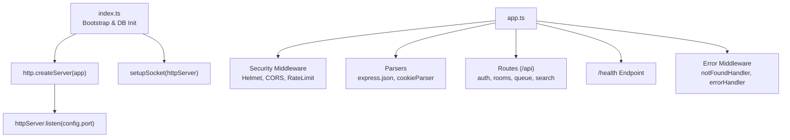

# 05. Backend Architecture & Server Implementation

## 1. Server Architecture & Lifecycle

The backend (`packages/server`) is an Express application written in TypeScript that binds an HTTP server instance with a `Socket.IO` engine.



### Server Initialization Sequence (`src/index.ts`)
1. Calls `createDbClient()` from `config/database.ts` to initialize the Supabase client. If environment variables are absent, logs a warning and proceeds without crashing.
2. Wraps the Express `app` with `http.createServer(app)`.
3. Passes the HTTP server into `setupSocket(httpServer)`.
4. Listens on `config.port` (default `4000`).
5. Handles OS termination signals (`SIGTERM`, `SIGINT`) to close open sockets and gracefully terminate HTTP connections.

---

## 2. API Routing & Middleware Layer

The REST API is mounted at `/api` via `src/routes/index.ts`:

- **`/api/auth` (`routes/auth.routes.ts`)**:
  - `POST /register`: Registers new user (`username`, `email`, `password`) via `registerSchema`.
  - `POST /login`: Authenticates user credentials via `loginSchema`.
  - `GET /me`: Fetches profile for the currently authenticated user (`authenticate` middleware).
- **`/api/rooms` (`routes/room.routes.ts`)**:
  - `POST /`: Creates a room (`authenticate`, `createRoomSchema`).
  - `POST /join`: Joins a room by code (`authenticate`, `joinRoomSchema`).
  - `GET /`: Lists active rooms for the user (`authenticate`).
  - `GET /:id`: Retrieves room details, queue, and members (public).
  - `POST /:id/leave`: Leaves a room (`authenticate`).
  - `POST /:id/transfer`: Transfers host role (`authenticate`, `transferHostSchema`).
  - `POST /:id/end`: Closes the room permanently (`authenticate`).
- **`/api/rooms/:roomId/queue` (`routes/queue.routes.ts`)**:
  - `GET /`: Fetches unplayed queue items (public).
  - `POST /`: Adds a song to the queue (`authenticate`, `addSongSchema`).
  - `DELETE /:itemId`: Removes a song from the queue (`authenticate`).
  - `PUT /reorder`: Reorders queue positions (`authenticate`, `reorderQueueSchema`).
- **`/api/search` (`routes/search.routes.ts`)**:
  - `GET /?q=...`: Searches for songs by text query.

### Middleware Implementation:
1. **`auth.middleware.ts`**:
   - `authenticate`: Extracts `Authorization: Bearer <token>`, validates HMAC signature with `verifyToken()`, and attaches `req.user = { userId, role }`. Rejects missing/malformed tokens with `401 Unauthorized`.
   - `optionalAuth`: Attempts decoding if header is present, but allows the request to continue unauthenticated if absent.
2. **`validate.middleware.ts`**:
   - Takes a Zod schema, validates `req.body`, and returns formatted `400 Bad Request` with field-level issues if invalid.
3. **`error.middleware.ts`**:
   - `AppError` class extending `Error` with `statusCode` and error `code`.
   - `errorHandler`: Global catch-all formatting errors into standardized `{ success: false, error: { message, code } }` structures.

---

## 3. Real-Time Socket Architecture (`src/sockets`)

Socket.IO handles real-time coordination across clients in individual rooms:

### Connection Handshake & Authentication (`src/sockets/index.ts`)
```typescript
io.use((socket, next) => {
  const token = socket.handshake.auth?.token || socket.handshake.query?.token;
  if (!token) return next(new Error('Authentication required'));
  try {
    const decoded = verifyToken(token);
    socket.data.userId = decoded.userId;
    socket.data.role = decoded.role;
    next();
  } catch {
    next(new Error('Invalid token'));
  }
});
```
Every socket connection must possess a signed JWT token. Guests without tokens cannot establish a socket connection.

### In-Memory Playback State Engine (`src/sockets/playback.socket.ts`)
The server maintains playback state in an ephemeral Node.js memory map:
```typescript
interface RoomPlaybackState {
  currentTrack: QueueItem | null;
  playbackState: 'playing' | 'paused' | 'stopped';
  playbackPosition: number;
  playbackStartTime: number | null;
  playedTrackIds: Set<string>;
}
const roomPlaybackStates = new Map<string, RoomPlaybackState>();
```
- When a track begins playing, `playbackStartTime = Date.now()` is recorded.
- When `request_sync` is emitted, elapsed time is computed as:
  ```typescript
  position = state.playbackPosition + (Date.now() - state.playbackStartTime) / 1000;
  ```
- **Flaws Identified**:
  1. If the Node.js server process restarts or spins up multiple worker instances, all playback state and active tracking are lost.
  2. No Video Mode flag (`isVideoMode: boolean`) is stored or synchronized.
  3. The `play`, `pause`, and `seek` socket handlers do not verify whether the sender is the room host! Any connected member can emit `seek` or `pause` and alter the room state.

---

## 4. Search & YouTube Music Integration (`src/services/search.service.ts`)

The search service is responsible for discovering music items to add to the playlist queue:

1. **Primary Attempt**: Calls `http://localhost:5000/search` with parameters `q`, `part: 'snippet'`, `maxResults: 20`, `type: 'video'`, `videoCategoryId: '10'`. This assumes an external local microservice (such as a Python `ytmusicapi` instance) is running on port 5000.
2. **Fallback Attempt**: When `http://localhost:5000` is unreachable, it issues a GET request to `https://www.youtube.com/results?search_query=...` with a desktop Chrome User-Agent header, parses `ytInitialData` from the HTML using regular expressions, and extracts video renderer objects.
3. **Limitation**: The parsed results are generic YouTube videos. There is no YouTube Music counterpart resolution or indication of whether the item is an audio-only release or has an official music video counterpart.
