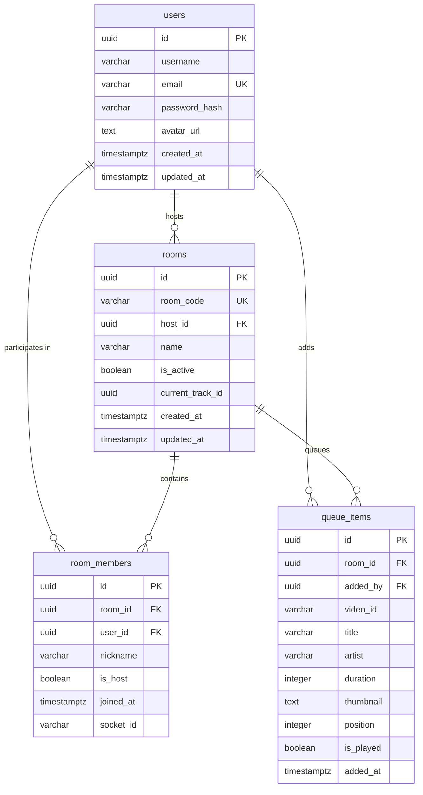

# 06. Database Schema & Migration Analysis

## 1. Relational Database Overview

The application utilizes PostgreSQL (hosted on Supabase) with 4 migration scripts located in `/migrations/`.

---

## 2. Table-by-Table Breakdown

### 1. `users` (`001_create_users.sql`)
- **`id` (UUID, Primary Key)**: Defaults to `gen_random_uuid()` via `pgcrypto`.
- **`username` (VARCHAR(50), NOT NULL)**: Display username.
- **`email` (VARCHAR(255), UNIQUE, NOT NULL)**: User login email. Indexed via `idx_users_email`.
- **`password_hash` (VARCHAR(255), NOT NULL)**: Bcrypt hash.
- **`avatar_url` (TEXT, NULLABLE)**: Optional profile avatar image.
- **`created_at` / `updated_at` (TIMESTAMPTZ)**: Automatic timestamp triggers via `update_updated_at_column()`.

### 2. `rooms` (`002_create_rooms.sql`)
- **`id` (UUID, Primary Key)**: Room identifier.
- **`room_code` (VARCHAR(10), UNIQUE, NOT NULL)**: 6-character human-readable alphanumeric join code (e.g., `ABC123`). Indexed via `idx_rooms_room_code`.
- **`host_id` (UUID, Foreign Key -> `users.id` ON DELETE SET NULL)**: Creator/owner of the room.
- **`name` (VARCHAR(100), NULLABLE)**: Optional display name for the room.
- **`is_active` (BOOLEAN, DEFAULT TRUE)**: Active status flag.
- **`current_track_id` (UUID, NULLABLE)**: Foreign reference to the active `queue_items.id`.
- **`created_at` / `updated_at` (TIMESTAMPTZ)**: Managed via trigger.

### 3. `room_members` (`003_create_room_members.sql`)
- **`id` (UUID, Primary Key)**: Membership record ID.
- **`room_id` (UUID, Foreign Key -> `rooms.id` ON DELETE CASCADE)**: Joined room.
- **`user_id` (UUID, Foreign Key -> `users.id` ON DELETE CASCADE)**: Joined user ID.
- **`nickname` (VARCHAR(50), NOT NULL)**: Participant display nickname.
- **`is_host` (BOOLEAN, DEFAULT FALSE)**: Indicates room administration privilege.
- **`joined_at` (TIMESTAMPTZ, DEFAULT NOW())**: Timestamp when member joined.
- **`socket_id` (VARCHAR(255), NULLABLE)**: Associated Socket.IO client ID.
- **Database Trigger**: `trigger_auto_deactivate_room` executes `auto_deactivate_empty_room()` after delete; if no members remain in the room, it sets `rooms.is_active = FALSE`.

### 4. `queue_items` (`004_create_queue_items.sql`)
- **`id` (UUID, Primary Key)**: Track item ID.
- **`room_id` (UUID, Foreign Key -> `rooms.id` ON DELETE CASCADE)**: Associated room.
- **`added_by` (UUID, Foreign Key -> `users.id` ON DELETE SET NULL)**: Member who queued the song.
- **`video_id` (VARCHAR(50), NOT NULL)**: YouTube video ID.
- **`title` (VARCHAR(255), NOT NULL)**: Track title.
- **`artist` (VARCHAR(255), DEFAULT '')**: Artist / creator name.
- **`duration` (INTEGER, NOT NULL)**: Song duration in seconds.
- **`thumbnail` (TEXT, NULLABLE)**: Cover art thumbnail URL.
- **`position` (INTEGER, NOT NULL)**: Zero-based queue index order.
- **`is_played` (BOOLEAN, DEFAULT FALSE)**: Marked true when completed or skipped.
- **`added_at` (TIMESTAMPTZ, DEFAULT NOW())**: Enqueue timestamp.

---

## 3. Schema Deficiencies & Limitations for Video Party Mode

1. **Foreign Key Constraint Prevents Guest Users**:
   - `room_members.user_id` has a strict foreign key `REFERENCES users(id) ON DELETE CASCADE`.
   - If an unauthenticated guest attempts to join with an ephemeral UUID, PostgreSQL rejects the insert with a foreign key violation (`violates foreign key constraint "room_members_user_id_fkey"`).
   - `user_id` in `room_members` and `added_by` in `queue_items` must either allow nulls or reference a polymorphic guest session identity.
2. **Missing Video Counterpart ID in `queue_items`**:
   - `queue_items` only contains a single `video_id` column.
   - To support YouTube Music's native Audio/Video switching, each queue item must store:
     - `audio_video_id`: The ID for the song/art-track.
     - `music_video_id`: The corresponding official music video ID (if available).
     - `has_video`: A boolean flag indicating whether Video Mode is supported for this track.
3. **Missing Playback State in `rooms`**:
   - The `rooms` table does not store the authoritative playback mode (`mode: 'audio' | 'video'`), `playback_state` (`playing` | `paused`), or `last_synced_position`.
   - All playback state currently lives in Node.js RAM (`roomPlaybackStates` map). If the backend is restarted or deployed on a serverless/container platform, rooms lose their current playing track and position.
