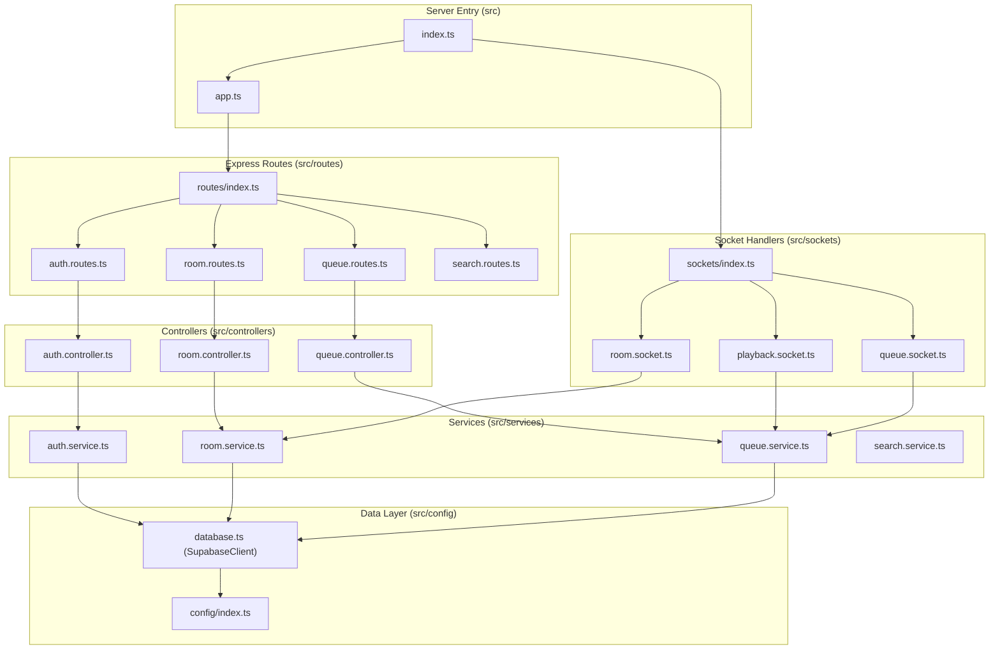
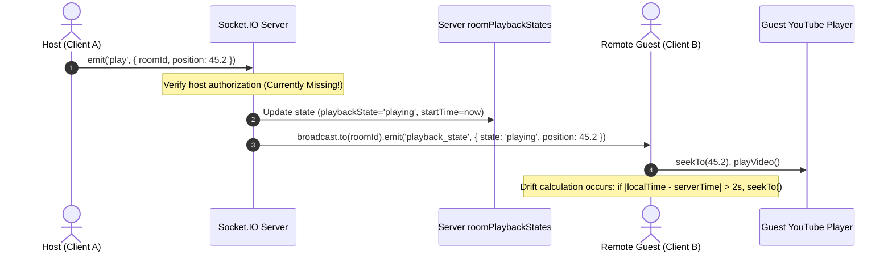

# 11. Module Dependency Map & Architecture Diagrams

This document maps the architectural dependencies and data flows between modules across both client and server packages.

---

## 1. Client-Side Module Dependency Map

```mermaid
graph TD
    subgraph AppRouter["Next.js Pages (src/app)"]
        Landing["page.tsx"]
        Room["room/[id]/page.tsx"]
        Join["join/[code]/page.tsx"]
        Login["login/page.tsx"]
        Signup["signup/page.tsx"]
    end

    subgraph Presentation["Components (src/components)"]
        Hero["landing/Hero.tsx"]
        CreateCard["landing/CreateRoomCard.tsx"]
        JoinCard["landing/JoinRoomCard.tsx"]
        PlayerComp["room/Player.tsx"]
        FooterControls["room/FooterPlayerControls.tsx"]
        QueueComp["room/Queue.tsx"]
        SearchComp["room/SearchBar.tsx"]
        MemberList["room/MemberList.tsx"]
        HostControls["room/HostControls.tsx"]
        InviteBtn["room/InviteButton.tsx"]
    end

    subgraph Hooks["Custom Hooks (src/hooks)"]
        usePlayer["usePlayer.ts"]
        useRoom["useRoom.ts"]
        useQueue["useQueue.ts"]
        useSocket["useSocket.ts"]
        useTheme["useThemeColors.ts"]
    end

    subgraph State["Zustand Stores (src/store)"]
        authStore["authStore.ts"]
        roomStore["roomStore.ts"]
        queueStore["queueStore.ts"]
        playerStore["playerStore.ts"]
        themeStore["themeStore.ts"]
    end

    subgraph Services["API Services (src/services)"]
        apiClient["api.ts (Fetch Wrapper)"]
        authService["auth.ts"]
        roomService["room.ts"]
        searchService["search.ts"]
    end

    subgraph RealTime["Sockets (src/sockets)"]
        socketClient["index.ts (socket.io-client)"]
        socketEvents["events.ts"]
    end

    Landing --> Hero
    Landing --> CreateCard
    Landing --> JoinCard
    Room --> PlayerComp
    Room --> FooterControls
    Room --> QueueComp
    Room --> SearchComp
    Room --> MemberList
    Room --> InviteBtn
    Room --> HostControls

    PlayerComp --> usePlayer
    PlayerComp --> useSocket
    PlayerComp --> useTheme
    QueueComp --> useQueue
    Room --> useRoom

    usePlayer --> playerStore
    useRoom --> roomStore
    useQueue --> queueStore
    useSocket --> socketClient
    useTheme --> themeStore

    CreateCard --> roomService
    JoinCard --> roomService
    SearchComp --> searchService
    authService --> apiClient
    roomService --> apiClient
    searchService --> apiClient

    socketClient --> socketEvents
```

---

## 2. Server-Side Module Dependency Map

---

## 3. Real-Time Data Flow: Media Playback Event Cycle

