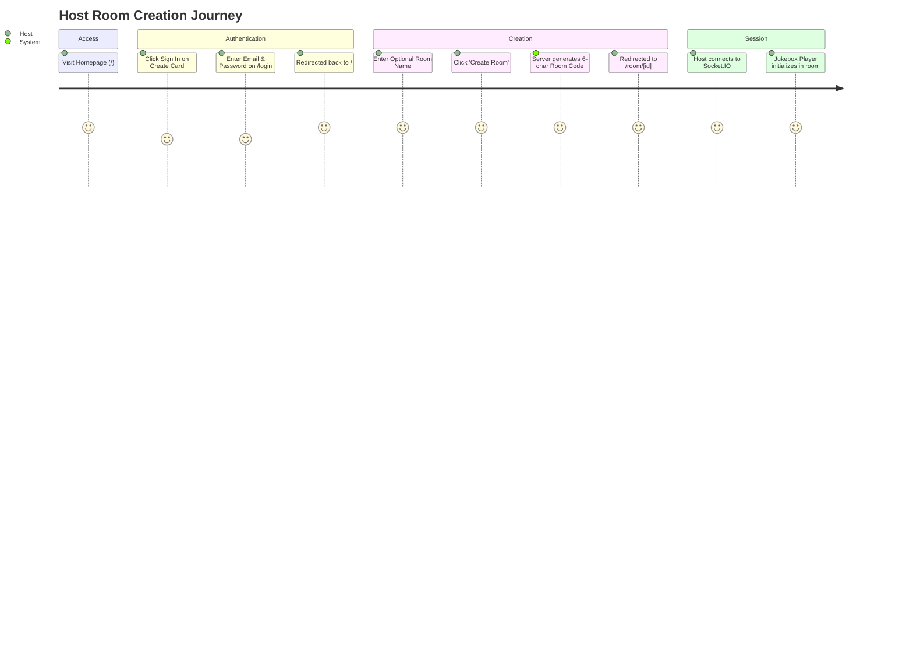
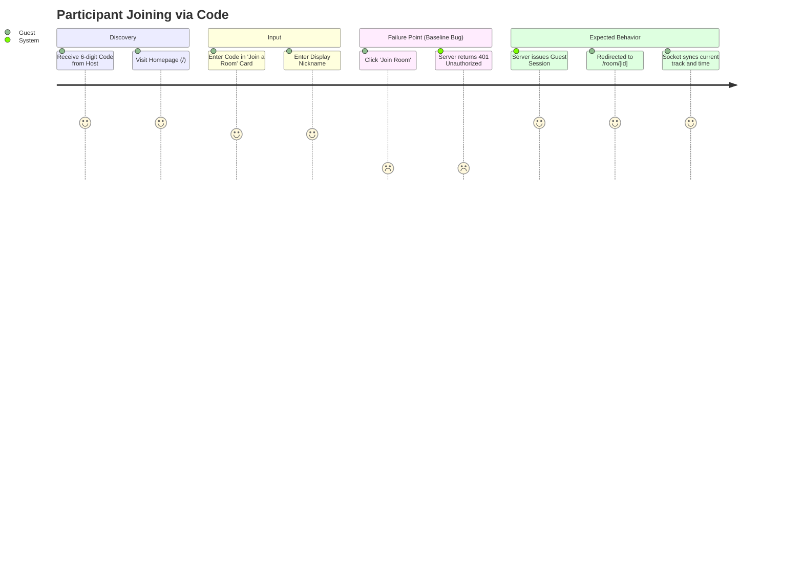

# 12. User Journeys & Complete Navigation Flow

This document details all primary user journeys, step-by-step state transitions, and interaction points.

---

## 1. Journey 1: Host Room Creation



1. **Step 1: Arrive at `/`**:
   The user visits the root URL. If unauthenticated, `CreateRoomCard` displays a locked state prompting sign-in.
2. **Step 2: Sign in at `/login`**:
   The user clicks "Sign In", enters email and password, and receives a JWT stored in `localStorage`. They are redirected back to `/`.
3. **Step 3: Create Room**:
   `CreateRoomCard` is now unlocked. The user types an optional name (e.g., "Friday Hits") and clicks "Create Room".
4. **Step 4: Server Processing**:
   `POST /api/rooms` creates a new row in `rooms`, assigns the user as host, generates a unique 6-character code, and creates a member row in `room_members`.
5. **Step 5: Transition to `/room/[id]`**:
   The router navigates to `/room/{roomId}`. The client connects to Socket.IO passing the JWT, joins the room channel, and sets `isHost = true`.

---

## 2. Journey 2: Remote Participant Joining via Room Code



1. **Step 1**: Guest opens `/` and locates the "Join a Room" card.
2. **Step 2**: Guest inputs the 6-character code (e.g., `KT7X9A`) and their nickname (e.g., `Alex`).
3. **Step 3 (Current Bug)**:
   Guest clicks "Join Room". Because no auth token is stored, `api.ts` sends an unauthenticated POST request to `/api/rooms/join`. The server's `authenticate` middleware immediately returns `401 Unauthorized` (`AUTH_REQUIRED`), and the user is blocked with an error banner.
4. **Target Resolved Flow**:
   Guest clicks "Join Room". The server recognizes an unauthenticated guest, creates an ephemeral guest session with a guest JWT, records the guest in `room_members`, and returns `{ room, member, token }`. The client stores the guest token, connects to Socket.IO, and enters the room.

---

## 3. Journey 3: Participant Joining via QR Code or Direct Link

1. **Step 1: Host Shares Link / QR Code**:
   The host clicks the "Invite" button inside the room. A QR code and URL (e.g., `https://jukebox.example.com/join/KT7X9A`) are generated.
2. **Step 2: Guest Scans or Clicks**:
   The guest scans the QR code with their smartphone camera or taps the link in a messaging app.
3. **Step 3: Arrival at `/join/[code]`**:
   The `/join/[code]` route renders with the room code prefilled and locked.
4. **Step 4: Nickname Entry & Submission**:
   Guest enters their desired display name and taps "Join Room".
5. **Step 5: Immediate Playback Sync**:
   Guest lands on `/room/[id]`. The player detects mobile browser environment, displays a one-tap "Tap to Start / Power On" prompt (required by browser autoplay security policies), and automatically seeks to the host's exact playback position upon tapping.

---

## 4. Journey 4: YouTube Music Song Selection & Queue Management

```mermaid
sequenceDiagram
    actor Participant as Participant / Host
    participant SearchUI as SearchBar Component
    participant Backend as Backend (/api/search)
    participant SocketServer as Socket.IO Server
    participant RoomMembers as All Participants in Room

    Participant->>SearchUI: Types "Starboy" (debounced 300ms)
    SearchUI->>Backend: GET /api/search?q=Starboy
    Backend-->>SearchUI: Returns 20 matched songs with duration & artwork
    SearchUI-->>Participant: Renders dropdown search results
    Participant->>SearchUI: Clicks "Add to Queue" button
    SearchUI->>SocketServer: emit('add_song', { roomId, videoId, title, ... })
    Note over SocketServer: Verify cooldown (<30s) and quota (<7 songs)
    SocketServer->>Backend: Inserts item into queue_items
    SocketServer->>RoomMembers: emit('queue_updated', { queue })
    alt Room Queue Was Empty
        SocketServer->>RoomMembers: emit('track_changed', { track })
        SocketServer->>RoomMembers: emit('playback_state', { state: 'playing', position: 0 })
    end
```

---

## 5. Journey 5: Native YouTube Music Video Mode Switching (Target Feature)

1. **Step 1: Host Plays Track**:
   Host plays an official track. The system checks if a music video counterpart ID is associated with the song.
2. **Step 2: Video Mode Toggle Indicator**:
   If a music video is available on YouTube Music, an animated "Video Mode" switch button lights up on the host's control bar.
3. **Step 3: Host Activates Video Mode**:
   Host clicks "Switch to Video Mode".
4. **Step 4: Socket Broadcast**:
   Host client emits `toggle_video_mode { roomId, isVideoMode: true, position: currentTime }`.
5. **Step 5: Participant Convergence**:
   All participants receive the `video_mode_changed` event:
   - The UI transitions smoothly from the album art visualizer to the responsive 16:9 official YouTube music video player.
   - The video seamlessly seeks to `currentTime` so no music is interrupted.
   - If a participant is on a restricted mobile device or regional block, a graceful fallback banner explains the restriction while maintaining synchronized audio playback.
