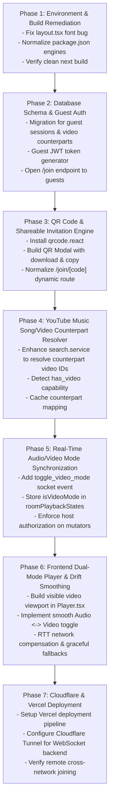

# 19. Implementation Roadmap & Execution Plan

This roadmap provides an ordered, phased execution plan to transform the existing Jukebox codebase into the target YouTube Music Video Party platform.

---

## Phase Breakdown & Milestone Schedule

---

## Detailed Task Breakdown

### Milestone 1: Environment & Build Remediation
- **Files Modified**: `packages/client/src/app/layout.tsx`, `package.json`, `packages/server/package.json`.
- **Tasks**:
  1. Fix the `Cormorant_Garamond` weight definition in `layout.tsx` to restore `next build` success.
  2. Relax Node engine requirements to `>=20.0.0` in `packages/server/package.json`.
  3. Verify that `npm run build` completes with exit code 0.

### Milestone 2: Guest Authentication & Database Schema
- **Files Modified / Created**:
  - `migrations/005_add_guest_and_video_mode.sql`
  - `packages/server/src/middleware/auth.middleware.ts`
  - `packages/server/src/routes/room.routes.ts`
  - `packages/server/src/services/room.service.ts`
  - `packages/server/src/sockets/index.ts`
- **Tasks**:
  1. Add nullable `guest_id` or relax foreign key constraint in `room_members`.
  2. Add `audio_video_id`, `music_video_id`, and `has_video` columns to `queue_items`.
  3. Update `/api/rooms/join` to allow unauthenticated requests and return an ephemeral guest JWT.
  4. Allow guest JWTs in Socket.IO handshake.

### Milestone 3: Automatic QR Code & Invitation System
- **Files Modified / Created**:
  - `packages/client/package.json` (add `qrcode.react`)
  - `packages/client/src/components/room/InviteButton.tsx`
  - `packages/client/src/components/room/QRCodeModal.tsx`
  - `packages/client/src/app/join/[code]/page.tsx`
- **Tasks**:
  1. Install `qrcode.react`.
  2. Create an "Invite & QR Code" modal displaying the room's unique QR code and invitation URL.
  3. Add a "Download QR Code" PNG feature and copy button.
  4. Ensure `/join/[code]` seamlessly logs the guest in and redirects to the room.

### Milestone 4: YouTube Music Song/Video Counterpart Resolver
- **Files Modified**:
  - `packages/server/src/services/search.service.ts`
  - `packages/server/src/types/index.ts`
  - `packages/client/src/types/index.ts`
- **Tasks**:
  1. Implement YouTube Music counterpart resolution logic in `search.service.ts`.
  2. Extract both `audioVideoId` and `musicVideoId` when querying tracks.
  3. Populate `hasVideo: true` when a verified music video counterpart is discovered.

### Milestone 5: Real-Time Audio/Video Mode & Playback Synchronization
- **Files Modified**:
  - `packages/server/src/sockets/playback.socket.ts`
  - `packages/server/src/types/socket.ts`
  - `packages/client/src/sockets/events.ts`
  - `packages/client/src/hooks/usePlayer.ts`
- **Tasks**:
  1. Add `toggle_video_mode` event to Socket.IO handlers.
  2. Track `isVideoMode: boolean` in `roomPlaybackStates`.
  3. Enforce host role verification on `play`, `pause`, `seek`, and `toggle_video_mode`.
  4. Broadcast `video_mode_changed` to all connected participants.
  5. Include `isVideoMode` and server timestamps in `sync_state` for late joiners.

### Milestone 6: Dual-Mode Player & Graceful Fallback UI
- **Files Modified**:
  - `packages/client/src/components/room/Player.tsx`
  - `packages/client/src/components/room/FooterPlayerControls.tsx`
  - `packages/client/src/hooks/usePlayer.ts`
- **Tasks**:
  1. Refactor `usePlayer.ts` to attach the YouTube IFrame Player to a visible container inside `Player.tsx`.
  2. Implement visual transition between Audio mode (art visualizer) and Video mode (16:9 responsive viewport).
  3. Add a "Switch to Video Mode" / "Switch to Audio Mode" button in the player controls (enabled when `hasVideo === true`).
  4. Detect embedding error codes (`101`, `150`) and trigger graceful fallback to audio.

### Milestone 7: Global Deployment & Verification
- **Tasks**:
  1. Connect GitHub repository to Vercel for frontend hosting.
  2. Configure production environment variables (`NEXT_PUBLIC_API_URL`, `NEXT_PUBLIC_SOCKET_URL`).
  3. Setup Cloudflare Tunnel (`cloudflared`) to expose the WebSocket backend over HTTPS/WSS.
  4. Conduct cross-network, multi-participant synchronization testing.
